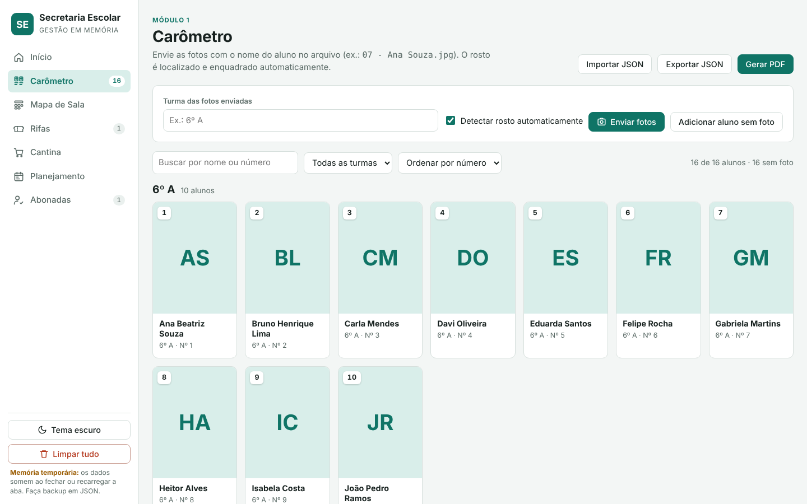
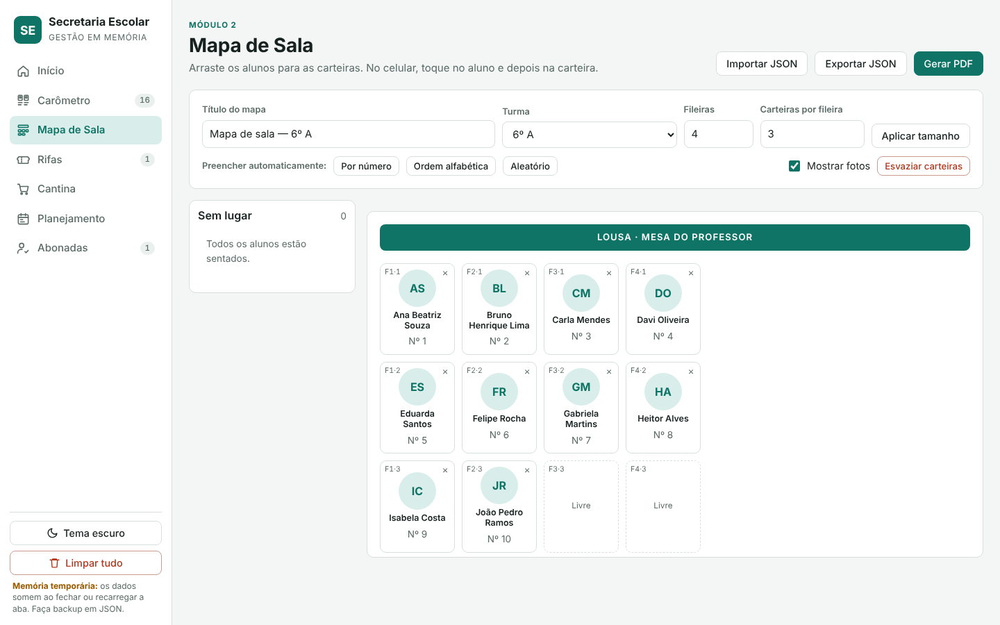
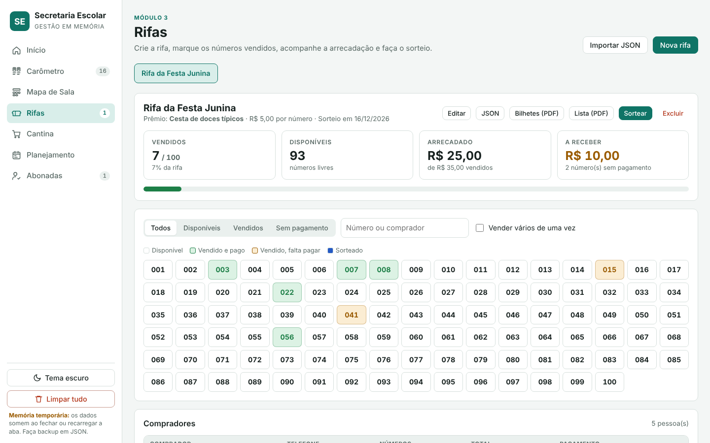
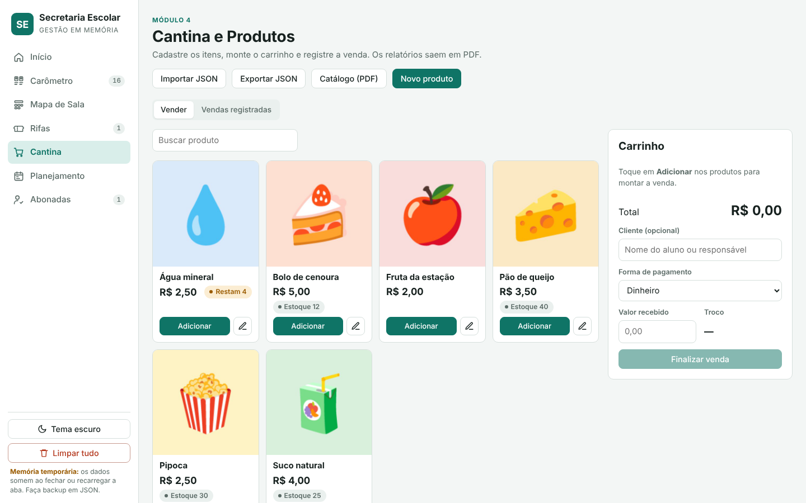
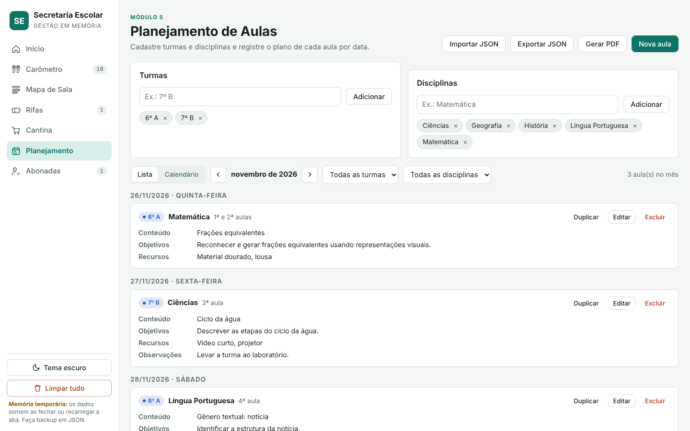
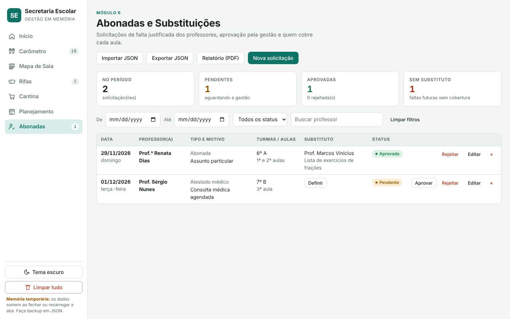
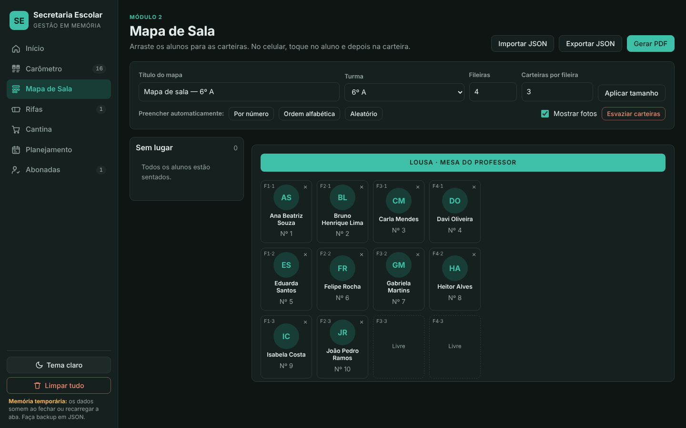

<div align="center">

# 🏫 Secretaria Escolar

**Gestão escolar completa que roda direto no navegador.**
<br>
Carômetro · Mapa de Sala · Rifas · Cantina · Planejamento de Aulas · Abonadas

<br>


<br>


<br>

### [🚀 Abrir o sistema](https://rxrichard.github.io/secretaria-escolar/)

</div>

---

## ✨ Por que usar

| | |
|---|---|
| 🔒 **Privado** | Fotos e dados dos alunos **nunca saem do computador**. Não há servidor nem cadastro. |
| ⚡ **Sem instalação** | É um único arquivo `index.html`. Abriu, funcionou. |
| 📄 **Tudo vira PDF** | Carômetro, mapa de sala, bilhetes de rifa, catálogo, comprovantes e relatórios. |
| 🤖 **Rosto automático** | As fotos dos alunos são enquadradas sozinhas no formato 3x4. |
| 📱 **Funciona no celular** | Layout responsivo, com toque no lugar de arrastar no mapa de sala. |

> [!WARNING]
> **Os dados ficam só na memória da aba.** Ao recarregar ou fechar a página, tudo é apagado.
> Antes de sair, use **Início → Exportar backup** e, na próxima vez, **Importar backup**.

---

## 🧭 Módulos

<table>
<tr>
<td width="50%" valign="top">

### 📸 Carômetro
- Envio de várias fotos de uma vez
- **Rosto detectado e recortado** automaticamente em 3x4
- Editor para ajustar o enquadramento (arrastar + zoom)
- Nome e número lidos do nome do arquivo
- Edição de nome, turma e número
- 📄 PDF por turma · 💾 JSON

</td>
<td width="50%" valign="top">

### 🪑 Mapa de Sala
- Fileiras e carteiras configuráveis
- **Arrastar e soltar** alunos nas carteiras
- Foto e nome em cada lugar
- Alunos importados do Carômetro
- Preenchimento por número, alfabético ou aleatório
- 📄 PDF · 💾 Exportar / importar JSON

</td>
</tr>
<tr>
<td valign="top">

### 🎟️ Rifas
- Nome, prêmio, valor, quantidade e data do sorteio
- Números gerados automaticamente
- Comprador, telefone e controle de pagamento
- Venda de vários números de uma vez
- **Sorteio animado** com resultado salvo
- 📄 Lista · 📄 Bilhetes com canhoto · 💾 JSON

</td>
<td valign="top">

### 🛒 Cantina e Produtos
- Produtos com foto, preço e estoque
- Carrinho com cálculo de troco
- Registro e cancelamento de vendas
- Resumo do dia por produto e forma de pagamento
- 📄 Catálogo · 📄 Comprovante · 📄 Relatório do dia
- 💾 JSON

</td>
</tr>
<tr>
<td valign="top">

### 📅 Planejamento de Aulas
- Cadastro de turmas e disciplinas
- Conteúdo, objetivos, recursos e observações
- Visualização em **lista** ou **calendário**
- Filtros por mês, turma e disciplina
- 📄 PDF · 💾 Exportar / importar JSON

</td>
<td valign="top">

### 🧑‍🏫 Abonadas e Substituições
- Solicitação com data, motivo e turmas afetadas
- Status **Pendente / Aprovada / Rejeitada**
- Quem cobre a aula e a atividade deixada
- Alerta de faltas **sem substituto**
- 📄 Relatório por período · 💾 JSON

</td>
</tr>
</table>

---

## 🖼️ Telas

<div align="center">

| Carômetro | Mapa de Sala |
|:---:|:---:|
|  |  |
| **Rifas** | **Cantina** |
|  |  |
| **Planejamento** | **Abonadas** |
|  |  |

**Tema escuro**



</div>

---

## 🚀 Como usar

1. Abra o sistema pelo link do GitHub Pages **ou** baixe o `index.html` e abra com dois cliques.
2. Em **Início**, digite o nome da escola e, se quiser, envie um logo ou qualquer imagem.
3. Quer conhecer antes? Clique em **Carregar dados de exemplo**. Depois use **Limpar tudo**.

> [!TIP]
> **Nomeie as fotos com o nome do aluno** para o carômetro preencher tudo sozinho:
>
> | Nome do arquivo | Resultado |
> |---|---|
> | `07 - Ana Souza.jpg` | Nº **7** · **Ana Souza** |
> | `Ana Souza - 7.jpg` | Nº **7** · **Ana Souza** |
> | `ana_souza.jpg` | sem número · **Ana Souza** |

<details>
<summary><b>💡 Mais dicas</b></summary>
<br>

- Fotos marcadas com **"Conferir"** não tiveram o rosto encontrado. Clique no aluno e use **Ajustar enquadramento**.
- No celular, para montar o mapa de sala, **toque no aluno e depois na carteira**.
- Na rifa, marque **Vender vários de uma vez** para vender vários números à mesma pessoa.
- Cada módulo tem **Exportar / Importar JSON** próprio. O **backup completo** fica na tela Início.
- Os bilhetes de rifa saem 5 por folha A4, com 5 mm entre eles para facilitar o corte.

</details>

---

## 🌐 Publicar no GitHub Pages

1. Envie `index.html`, `README.md` e a pasta `docs/` para o repositório usando **Add file → Upload files**.
   Não copie e cole o texto do README: envie o arquivo, para não perder a formatação.
2. Vá em **Settings → Pages**.
3. Em *Source*, escolha **Deploy from a branch**, a branch `main` e a pasta `/ (root)`, e clique em **Save**.
4. Em 1 ou 2 minutos o endereço aparece no topo da página. Atualize o link **🚀 Abrir o sistema** deste README.

> [!NOTE]
> Mesmo publicado na internet, **cada pessoa tem os próprios dados**, guardados só no navegador dela. Ninguém vê o que outra pessoa cadastrou.

---

## 🧩 Bibliotecas

| Biblioteca | Versão | Uso |
|---|:---:|---|
| [jsPDF](https://github.com/parallax/jsPDF) | 2.5.1 | Geração dos PDFs |
| [jsPDF-AutoTable](https://github.com/simonbengtsson/jsPDF-AutoTable) | 3.8.2 | Tabelas nos PDFs |
| [face-api](https://github.com/vladmandic/face-api) | 1.7.13 | Detecção de rosto (*Tiny Face Detector*), carregada só ao enviar fotos |
| [Inter](https://fonts.google.com/specimen/Inter) · [Bricolage Grotesque](https://fonts.google.com/specimen/Bricolage+Grotesque) | — | Fontes da interface |

As bibliotecas são carregadas por CDN (cdnjs, jsDelivr e Google Fonts), por isso é preciso **internet ao abrir** o sistema.

---

## ⚠️ Limitações

- **Sem internet**, os PDFs não são gerados e as fotos ficam apenas centralizadas, sem detecção de rosto.
- Fotos **HEIC** (padrão do iPhone) não são lidas. Converta para JPG antes de enviar.
- Centenas de fotos de uma vez podem deixar computadores mais simples lentos.
- Os comprovantes da cantina **não têm valor fiscal**.

---

<details>
<summary><b>🛠️ Para quem quiser modificar o código</b></summary>
<br>

Tudo está em `index.html`, em blocos comentados:

| Bloco | Conteúdo |
|---|---|
| `<style>` | Cores do tema (variáveis em `:root`), layout e componentes |
| 1. Estado em memória | Objeto `state` com todos os dados. `freshState()` define a estrutura |
| 2. Utilitários | Datas, moeda, toasts, modais, download e importação de arquivos |
| 3. Imagens e rosto | Redução, recorte 3x4 e uso do face-api |
| 4. PDF | Cabeçalho, rodapé e estilos de tabela |
| 6 a 11. Módulos | `Car`, `SeatMap`, `Rifa`, `Cantina`, `Plan`, `Abon` |
| 12. Aplicação | Navegação, início, tema, backup, exemplos e "Limpar tudo" |

Cada módulo tem `init()`, que liga os botões, e `render()`, que redesenha a tela. Depois de alterar o `state`, chame `App.refresh()`.

**Estrutura do repositório**

```
secretaria-escolar/
├── index.html      ← o sistema inteiro
├── README.md       ← este arquivo
└── docs/           ← imagens usadas no README
```

</details>

<div align="center">
<br>
<sub>Feito para facilitar o dia a dia da escola. 💚</sub>
</div>
